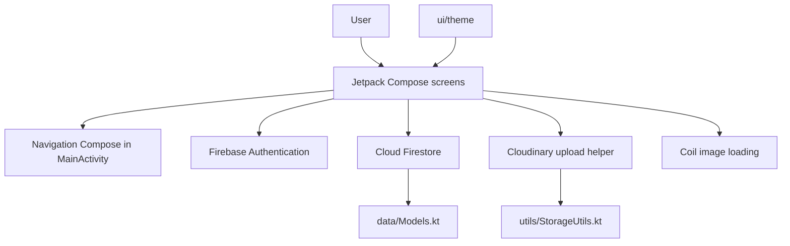

# Architecture

## Overview

OMNIRA is a single-module Android application. The application is organized by responsibility and feature screens rather than by a layered repository/domain architecture.

Screens currently access Firebase SDKs directly. There is no repository, use-case, dependency-injection, or offline synchronization layer in this codebase. Keep this in mind when extending features: asynchronous state, error handling, and access checks generally live in the relevant screen.

## Source layout

| Path | Responsibility |
| --- | --- |
| `MainActivity.kt` | Initializes the app UI, resolves the initial auth destination, and declares navigation routes |
| `data/Models.kt` | Kotlin data classes serialized to and from Firestore |
| `ui/screens/` | Authentication, dashboard, classroom, content, attendance, notification, chat, and inbox flows |
| `ui/components/` | Reusable Compose UI components |
| `ui/theme/` | Material theme, brand colors, typography, and neumorphic drawing helpers |
| `utils/StorageUtils.kt` | Cloudinary uploads, downloads, file names, and date helpers |
| `utils/AttendanceUtils.kt` | Attendance-related helpers |

## App startup and navigation

`OmniraApplication` initializes Cloudinary. `MainActivity` applies `OMNIRATheme` and hosts `AppNavigation`. The navigation graph chooses `dashboard` or `login` based on the current Firebase user, then routes to feature screens using Navigation Compose.

The classroom route accepts a class code and an optional initial tab. The inbox has a conversation-list route and a direct-message route keyed by recipient user ID.

`AppNavigation` observes validated network connectivity and overlays an offline banner across the app when no validated internet connection is available.

## Feature flows

### Classroom membership and moderation

1. A class is stored in `classes/{classCode}` with its creator and member IDs.
2. Joining by code creates a pending join request and admin-targeted notifications; it does not immediately add the requester to the member list.
3. An admin approves or declines the request from classroom alerts or the notifications screen.
4. The Students tab supports promotion, demotion, and removal. User-targeted notifications are stored in the shared notifications collection.

The creator is treated as an admin even when not present in the optional `admins` array. Existing and future permission-sensitive UI should use that same rule.

### Class content and approvals

Posts, comments, materials, assignments, routines, and attendance records are kept in class-scoped Firestore collections. Student stream posts and comments can be submitted as pending; approval alerts are routed to the class admins. The class bell subscribes to notifications addressed to that administrator.

### Chat and inbox

Class chat is stored under each class and supports read receipts, member-level hide state, attachments, retention settings (up to 12 months), edits, deletes, and reports. Direct conversations use a deterministic thread ID derived from the sorted pair of user IDs, with messages in a thread subcollection. Each user's inbox can hide a thread independently.

Media is uploaded through `uploadToCloudinary` and referenced by URL in Firestore. `Coil` displays image URLs and Android `DownloadManager` handles downloads.

### Account deletion

The Profile screen requires the user to type `DELETE` and re-enter their password. The client reauthenticates the email/password account, transfers classes owned by the user to an existing admin or member, removes memberships, and deletes supported Firestore records linked through user IDs. Firebase Authentication is deleted only after the Firestore cleanup succeeds. Deletion is blocked when an owned class has no other admin or member to receive ownership.

This is a multi-step client workflow, not an atomic server-side cascade. A failed request can leave some cleanup completed while the account still exists. The cleanup can only remove records with supported ownership fields; class records such as routines do not currently identify their author. Cloudinary uploads are not deleted.

## State and asynchronous work

Compose screen state is held with `remember`, `rememberSaveable`, effects, and Firestore snapshot listeners. Remove snapshot listener registrations in `DisposableEffect` cleanup. For new database operations:

- Report loading and write failures to users using the existing screen conventions.
- Keep UI state updates in success callbacks, not before a write succeeds.
- Avoid duplicate listeners when route parameters or user IDs change.
- Treat IDs and Firestore document paths as untrusted input.
- Enforce permissions with Firestore Rules or trusted server code; hiding an action in Compose alone is insufficient.

## Build configuration

The root Gradle build uses a version catalog. The app module is configured for Compose, Android SDK 35, Java/Kotlin bytecode target 11, and application ID `com.omnira`. Android Gradle Plugin 8.7.x requires a compatible JDK (JDK 17 is recommended).

## Known deployment work

- Review and test `firestore.rules`; several legacy class/profile/notification rules intentionally preserve broad authenticated-user access and need tightening before production.
- Publish the direct-message participant-removal rule in `firestore.rules` before releasing account deletion; test deletion against the production Firebase project and consider moving the multi-step cleanup to trusted backend code.
- Move privileged writes to trusted server code. Media uploads use an unsigned Cloudinary preset, which must be restricted in the Cloudinary dashboard.
- Keep API secrets out of Android source, Gradle BuildConfig, and the repository.
- Add automated tests for authorization, approval flows, message operations, and retention behavior.
